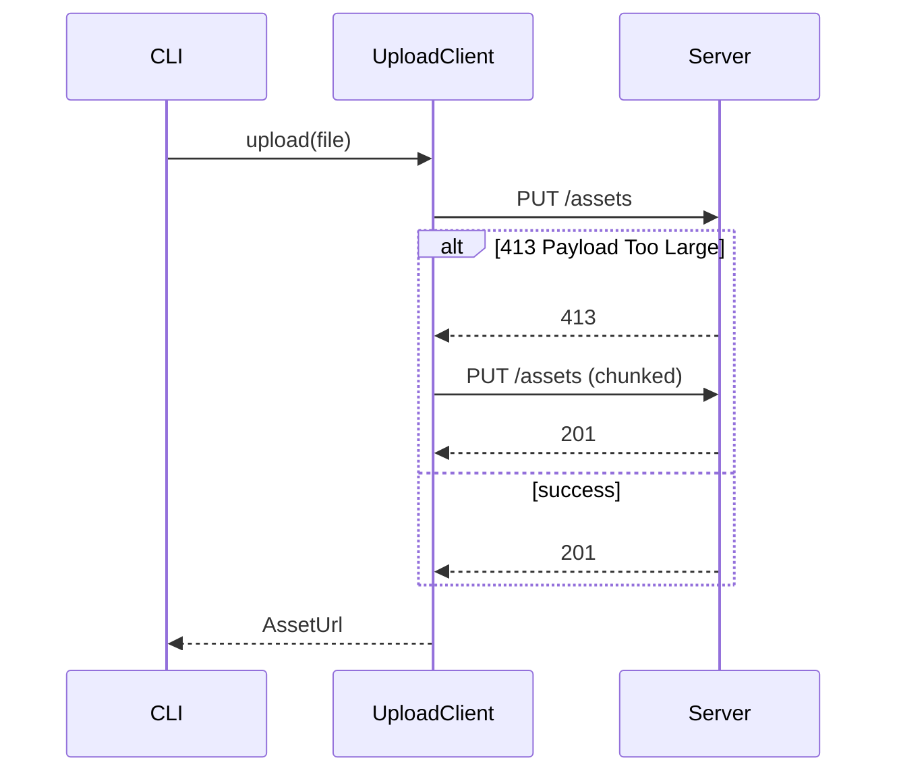

# PR Body Template

Pick sections by what the reviewer needs, not by what the template offers. Do not invent content to fill a heading. A small local change is a `Summary` (with its `- close #N` line), a `User prompts` block, and a `Verification` block.

## Summary

Lead with the problem or the capability, then the result and why this approach.

```markdown
## Summary

Uploads over ~10MB failed silently because the client dropped the response body on a 413.
This surfaces the error to the caller and retries once with chunked transfer.

- close #482
```

Closing issues: put each on its own line as a list item, `- close #123`, so GitHub renders them as pretty issue cards. Use `- refs #123` for issues the PR should not close.

For a larger PR, end the Summary with a plain-language `In short:` line of two or three sentences for readers outside the module. It doubles as a check: if it makes no sense, the change probably doesn't either.

For a stacked PR add a line such as `Stacked on #480; only the last two commits belong to this PR.`

## User prompts

Summarize what the user said during the session, so the reviewer can see the intent behind the change. Include only facts the user stated: requests, requirements, constraints, preferences, and corrections. Do not add the agent's interpretation, guesses, or reasoning. Paraphrase briefly, keep the order, and drop pleasantries and secrets.

```markdown
## User prompts

- Model: `claude-sonnet-5-5`, harness: `Claude Code`
- Asked to retry uploads that fail with 413.
- Said the retry must happen at most once.
- Corrected: surface the error in the CLI instead of logging it.
```

Start the section with one line naming the model and harness the agent ran on, as reported by the session itself (system prompt or environment). Do not guess; write `unknown` if it is not stated.

If the user gave only one request, one bullet is enough.

## Evidence by change type

A description conveys belief, not proof. Show the change working instead of saying it works. Put the matching proof in `Verification` (or a dedicated `## Evidence` section for larger PRs).

| Change | Evidence |
| --- | --- |
| Visible UI | Same page before and after, same size and crop; short video if it moves. See [visual-evidence](visual-evidence.md) |
| Bug fix | Same input on both sides, plus the output each time |
| Faster or cheaper | Same workload measured on both sides, more than once |
| Command or build output | Real captured output before and after, never retyped |
| New API | The code someone would write to use it |

- "Before" is what is live (base branch, production, last deploy), never a faked revert.
- Check every capture. Agents can confidently screenshot or measure the wrong thing.
- Use demo or sanitized data only.
- State what was not run, for example `Not checked in a browser yet.`
- Security fixes are the exception: keep the description short and delay exploit details until release.

## Change map

Use when the diff touches several modules or moves responsibility between them. Rows are modules or boundaries, not files.

```markdown
## Change map

| Module | Before | After | Description |
| --- | --- | --- | --- |
| `upload/client` | Swallowed non-2xx responses | Maps 413 to `PayloadTooLarge`, retries once chunked | Callers can distinguish size errors from network errors |
| `cli/upload` | Printed generic "failed" | Prints the mapped error and hint | Actionable output for users |
```

A short responsibility tree helps when the layout itself is the change:

```text
server/
├── routes/      # accept and validate input
├── domain/      # own the invariants
└── adapters/    # talk to external systems
```

## Architecture and behavior

Use a diagram when it explains the change faster than prose. Keep node names tied to real modules or symbols and label arrows with calls, events, or data.

- Module flow (`flowchart LR`) for a cross-module feature or boundary move.
- Sequence diagram for changed ordering, async work, retries, cancellation, or cleanup. Match each `alt` branch to a code branch.
- State diagram for changed transitions or terminal states.

For a fix that changes flow or state, show a `Before` and `After` pair at the same abstraction level, then name the exact edge or step that changed so the reader does not have to diff the diagrams.



When a diagram would be expected but does not apply, say so: `Not applicable: only renames a constant, no runtime flow changes.`

## Boundaries and risks

Use when the change has real failure modes, invariants, migrations, or external effects. Include only rows that matter.

```markdown
## Boundaries and risks

| Invariant or boundary | Failure mode | Protection | Evidence or gap |
| --- | --- | --- | --- |
| Retry happens at most once | Infinite loop on persistent 413 | `attempt` counter, hard cap of 1 | `upload.test.ts` "does not retry twice" |
| Chunked upload is idempotent | Duplicate asset on retry | Server dedupes by content hash | Not verified in this PR |
```

Risk groups to scan: input validation and auth; failure mapping, retries, duplicates, concurrency, ordering, cleanup; schema changes, backfills, rollback; secrets in logs or error payloads; UI loading, error, empty, stale, and repeated-action states.

Write `Not verified` instead of turning a risk question into a claim.

## Visual changes

Only for user-visible UI changes. Image row first, label row second. See [visual-evidence](visual-evidence.md) for capture and attachment.

```markdown
## Visual changes

| Before | After |
| --- | --- |
|  |  |
| Settings / Connection, 1440x900, dark | Settings / Connection, 1440x900, dark |
```

Use `Absent` for a new state and `Removed` for a deleted one.

## Rollout and follow-up

Optional. Migrations, feature flags, staged rollout, monitoring, known gaps, required follow-up PRs. State whether each gap blocks merge.

<!--
Source references:
- https://github.com/moeru-ai/airi/blob/main/.agents/skills/create-pr/references/pr-body.md
- https://hugorcd.com/writing/what-my-pull-requests-look-like-now (Hugo Richard: evidence by change type, honesty rules, plain-language ending)
-->
